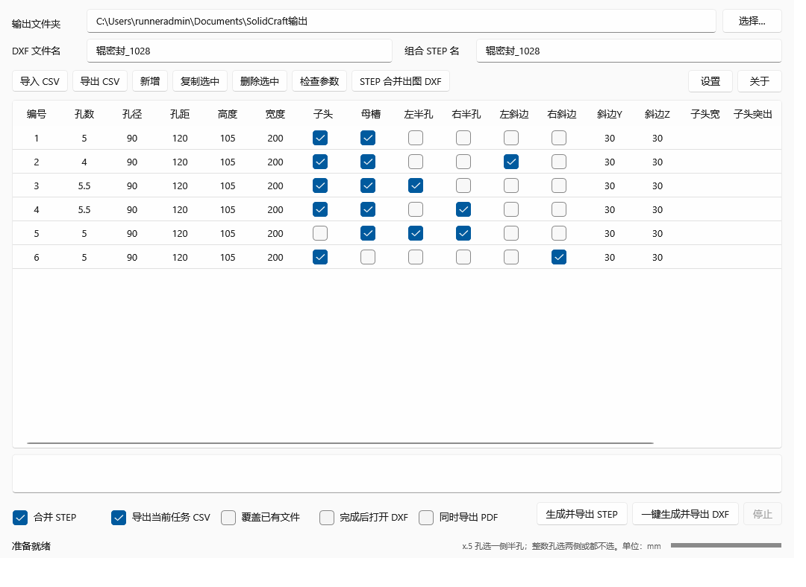
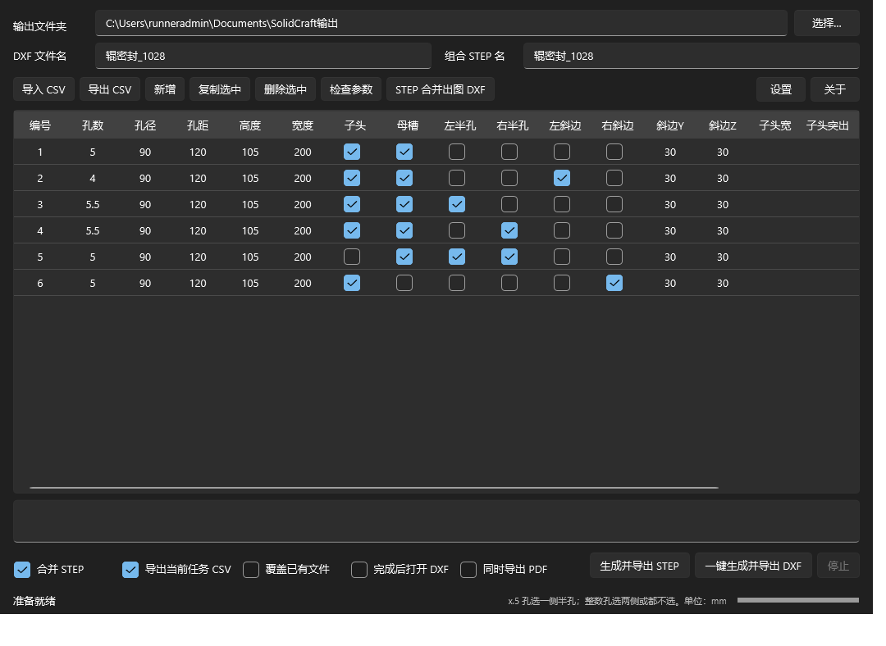
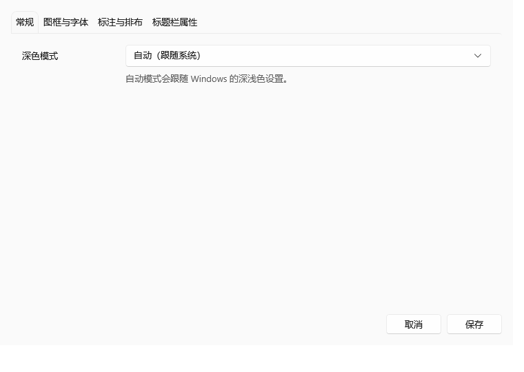
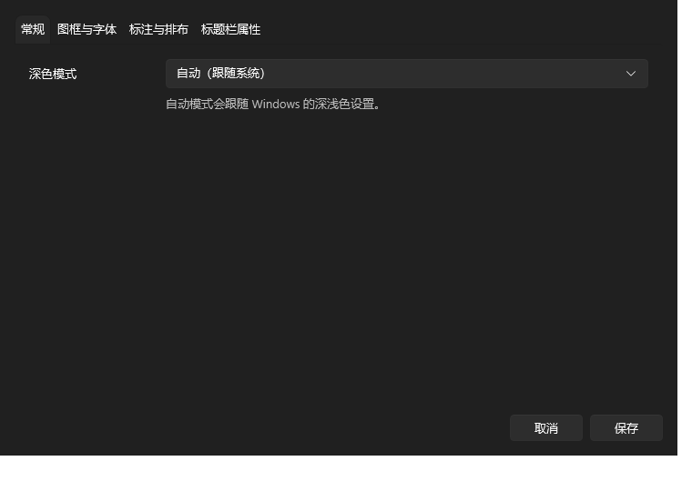
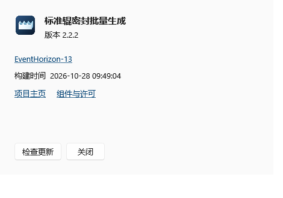
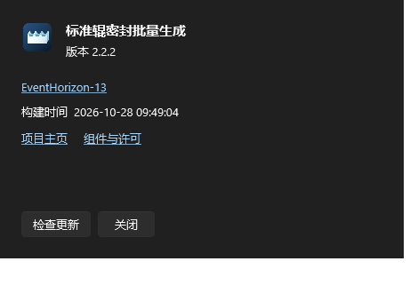

# 标准辊密封批量生成

面向标准辊密封零件的参数化建模与工程出图工具。通过参数表或 CSV 批量管理尺寸，自动调用随包提供的 SolidCraft CLI，生成三维模型和加工图文件。

**版本：2.4.6**

**支持平台：** Windows 10/11（x64、ARM64 桌面版）；Linux（amd64、ARM64 命令行版）。目前没有 macOS 桌面版。

[下载最新正式版](https://github.com/EventHorizon-13/solidcraft-roller-seal/releases/latest) · [查看所有版本](https://github.com/EventHorizon-13/solidcraft-roller-seal/releases) · [查看构建与 UI 测试](https://github.com/EventHorizon-13/solidcraft-roller-seal/actions)

## 2.4.6 更新说明

- Windows 桌面版记住上次正常窗口的宽度和高度；最大化退出时保存最大化前的尺寸，下次启动恢复。
- 内置官方 SolidCraft CLI 升级至 **0.28.0**，Windows x64/ARM64 与 Linux amd64/ARM64 构建统一使用该版本。
- 旧版 V13 标准模板可继续打开；注意 SolidCraft 0.28.0 保存的新设计使用文件格式 45，不能再由 0.27.x 或更早版本打开。

## 2.4.5 修复说明

- 修复上视图右侧半孔尺寸被附近投影边线吸附造成的偏差，改用对齐后的实际圆弧切线计算；例如 Ø90 的半孔应为 45。
- 新增 R35、R45、R47.5 半孔及干扰边线、坐标偏移回归检查，尺寸按实际几何计算。
- 保留完整半圆、外鼓半圆误拟合修复及孔位置与子头独立尺寸标注。

## 功能概览

- **批量参数化建模：** 从参数表或 CSV 生成单件 SolidCraft 原生模型与 STEP 文件，可选导出组合 STEP。
- **工程出图：** 在参数化建模会话中直接提取三视图并生成可编辑 DXF 和多页 A4 横向 PDF；无需关闭后重新打开模型，DXF-only 模式跳过单件 STEP 中间导出，启用组合 STEP 时仍按需生成 STEP。
- **WPS 风格填充：** 单格或矩形多格选区均可使用填充柄；拖动时实时预览，松开提交，取消则恢复原值。
- **序列与复制切换：** 按住 Ctrl 在序列填充和循环复制之间切换；支持数字、日期和带数字后缀的编号。
- **撤销与重做：** 支持 Ctrl+Z、Ctrl+Y 和 Ctrl+Shift+Z，填充、单元格编辑、整列修改、勾选切换及行操作均纳入历史记录。
- **高效表格操作：** 单击即可切换勾选框；双击勾选列列头可全选/取消全选，双击其他列头可批量修改整列。
- **深浅色主题：** 支持自动跟随系统、深色和浅色模式；当前单元格有明确外框，选中状态和设置选项卡均有高亮提示。
- **独立运行环境：** Windows 桌面版自包含 .NET；安装包附带对应架构的官方 SolidCraft 0.28.0 CLI。PDF 导出所需 Node.js 运行时和渲染器也随包提供。
- **窗口尺寸记忆：** 自动保存主窗口上次正常状态下的宽高；最大化关闭时保留最大化前尺寸。

## 界面截图

以下截图保存在仓库的 `assets/screenshots/` 中，可直接在 GitHub 上预览，不依赖会过期的 Actions 附件。

### 主界面

<p align="center">
  
  
</p>

### 出图设置

<p align="center">
  
  
</p>

### 关于页面

<p align="center">
  
  
</p>

截图由 Windows UI 自动化检查生成。自动化还会检查深浅色模式、参数表选中单元格边框、填充柄、设置选项卡高亮、更新确认窗口和关于窗口布局。

## 下载与安装

### Windows 桌面版

1. 打开[最新正式版下载页](https://github.com/EventHorizon-13/solidcraft-roller-seal/releases/latest)，根据电脑架构下载 `StandardRollerSeal-windows-amd64.zip` 或 `StandardRollerSeal-windows-arm64.zip`。
2. **完整解压 ZIP**，不要只复制 EXE。程序需要同目录中的 `SolidCraft`、`PdfExporter`、`模板` 等文件。
3. 运行 `标准辊密封批量生成.exe`。
4. 选择输出目录，然后导入 `辊密封参数模板.csv` 或直接编辑参数表。

### Linux 命令行版

根据设备架构下载 `StandardRollerSeal-linux-amd64.tar.gz` 或 `StandardRollerSeal-linux-arm64.tar.gz)，解压后运行：

```sh
./standard-roller-seal --help
./standard-roller-seal --csv 辊密封参数模板.csv --output ./输出
```

路径包含空格时，请使用 shell 引号。Linux 版本没有图形界面。

## 快速使用

1. **准备参数。** 导入模板 CSV，或在主界面直接编辑参数表。
2. **设置出图参数。** 打开“出图设置”，选择 DXF 图框、标注样式和字体目录；如需 PDF，必须指定固定 A4 图框。
3. **选择输出选项。** 按需启用组合 STEP、当前任务 CSV、覆盖已有文件、完成后打开 DXF 或同时导出 PDF。
4. **生成文件。** “生成并导出 STEP”生成模型和 STEP；“一键生成并导出 DXF”批量生成加工图。启用 PDF 时也会生成对应 DXF。

### 表格填充与快捷操作

- 拖动选区右下角的填充柄，可向上、下、左、右延伸，也可扩展为二维区域。
- **单个数字单元格：** 默认复制；按住 Ctrl 填充递增序列。
- **日期单元格：** 默认递增；按住 Ctrl 复制日期。
- **多格矩形选区：** 默认延续数字、日期或编号后缀序列；按住 Ctrl 循环复制整个选区。
- 拖动期间会显示目标区域和填充结果预览；松开鼠标提交填充，取消拖动则恢复原值。
- **Ctrl+Z** 撤销；**Ctrl+Y** 或 **Ctrl+Shift+Z** 重做。
- 单击勾选框即可切换。双击勾选列列头可全选/取消全选；双击其他列头可批量修改整列，编号列可按输入前缀自动编号。

## 输出文件

| 文件 | 用途 |
| --- | --- |
| `辊密封_MMDD_编号.solidcraft` | 单件原生模型 |
| `辊密封_MMDD_编号.step` | 单件 STEP 模型（普通 STEP 导出时生成；DXF-only 模式默认跳过） |
| `辊密封_MMDD.step` | 组合 STEP（可关闭、可自定义文件名） |
| `辊密封_MMDD.dxf` | 汇总 DXF 加工图 |
| `辊密封_MMDD.pdf` | 多页 A4 横向加工图 PDF |
| `辊密封_MMDD.csv` | 当前任务参数快照（可关闭） |

`MMDD` 是生成当天的月日。默认名称会自动更新日期；合并 STEP、CSV 导出、自定义名称、窗口宽高等设置会自动记住。

## CSV 参数说明

- 模板使用 **UTF-8 BOM**，单位为 **mm**；开关字段填写 `0` 或 `1`。
- 当前模板为 18 列，包含 6 行有效示例。旧 14 列 CSV 与旧版 19 列 CSV 均可导入；旧文件末尾的配合间隙值会被忽略。
- 四个可选尺寸列为 `子头宽`、`子头突出`、`母槽宽`、`母槽深`。填写数字时覆盖相应模板参数；留空时使用所选模板原始默认表达式。
- 孔数允许整数或 `x.5`。小数孔只能选择一侧半孔；整数孔须左右都不选，或同时选择半孔。
- 启用斜边时，斜边 Y 和斜边 Z 必须大于 0。
- 配合间隙不再是可编辑列或批量输入参数。V13 模板内部仍可引用自身的间隙参数，保持原有公式行为。

## DXF 与 PDF 出图

- DXF 使用第一角投影布局，在生成 `.solidcraft` 的同一后台会话中直接提取当前模型的三视图并生成尺寸标注，避免为出图重新打开模型；DXF 中的尺寸对象保持可编辑。DXF-only 模式不生成单件 STEP 中间文件；如果启用组合 STEP，则仍生成所需 STEP 文件。
- 默认标注样式为 `_5`。可在“出图设置”中选择本地图框、标注样式及标题栏属性；留空的标题栏字段保留模板原值。
- 仅导出 DXF 时可以不提供图框模板。**导出 PDF 时必须提供固定 A4 图框的 DXF 模板**，每个加工图框排成一张 A4 横向页面。
- PDF 字体需要用户自行提供且具有使用授权的 `gbenor.shx` 和 `gbcbig.shx`。字体不会随软件分发；可在出图设置中指定字体目录。
- PDF 将文字按矢量轮廓绘制；DXF 仍可编辑。正式用于加工前，请用实际图纸核对字体、图框、标注和 Logo。

## 运行环境与实现

- Windows 桌面程序：WPF、.NET 10，自包含发布。
- 三维建模：安装包附带官方 [SolidCraft 0.28.0 CLI](https://github.com/tangency-labs/solidcraft/releases/tag/v0.28.0)，后台运行，不需要手动打开 SolidCraft 窗口。
- Linux：自包含 .NET CLI，支持 amd64 和 arm64。
- PDF：使用开源 DXF 数据模型与矢量渲染器，并随安装包提供 Node.js 运行时；不包含 ODA 或专有 SDK。
- 默认组合间距固定为 10 mm，后台控制端口固定为 7878。桌面版使用内置标准辊密封模型；CLI 可通过 `--template` 指定其他 V13 `.solidcraft` 模板。

## Linux CLI 常用参数

```sh
./standard-roller-seal --csv 辊密封参数模板.csv --output ./输出
```

常用参数：

| 参数 | 说明 |
| --- | --- |
| `--template 路径` | 指定其他 V13 `.solidcraft` 模板 |
| `--output 路径` | 指定输出目录 |
| `--combine-step` | 输出组合 STEP |
| `--export-current-csv` | 保存当前任务参数 |
| `--export-dxf` | 直接从 `.solidcraft` 输出 DXF，默认跳过单件 STEP 中间文件 |
| `--drawing-template 路径` | 指定 DXF 图框模板 |
| `--export-pdf` | 同时输出 DXF 和多页 PDF |
| `--font-dir 路径` | 指定包含授权 SHX 字体的目录 |
| `--dimension-style _5` | 指定标注样式 |
| `--overwrite` | 覆盖同名文件 |

更多参数请运行 `./standard-roller-seal --help`。

## 构建与测试

正式安装包由 GitHub Actions 构建，发布 Windows x64/ARM64 桌面版和 Linux amd64/ARM64 CLI。Windows 2022 与 Windows 2025 工作流会执行构建、核心检查和 UI 外观验证。

本地构建桌面项目需要 .NET 10 SDK：

```powershell
dotnet build src/SolidCraftCsvTool/SolidCraftCsvTool.csproj -c Release -p:Version=2.4.6
```

第三方组件及许可信息见 [THIRD_PARTY_NOTICES.md](THIRD_PARTY_NOTICES.md)。项目主页：[GitHub](https://github.com/EventHorizon-13/solidcraft-roller-seal)。

## Web Preview：上传图框和字体（0.1.1）

Web 版本的“输出设置 → 图框与字体”支持选择固定 A4 DXF 图框以及您有权使用的 `gbenor.shx`、`gbcbig.shx`，点击“上传并使用”。可以先传图框、再补传字体；补传保留当前资源的其他文件。刷新同一浏览器标签后继续使用所选资源。“使用内置资源”切回安装包默认值。上传资源存放在服务端 `WebData/resources/`，不在公开静态目录中；升级时应保留 WebData，字体和私人图框不会发布到 GitHub。

- `POST /api/resources`：multipart/form-data，文件字段 `drawingTemplate`（单个 .dxf，最大 8 MiB）、`fonts`（最多两个，文件名仅允许 gbenor.shx 和 gbcbig.shx，各最大 4 MiB）。可选字符串字段 `resourceId` 指向之前上传的资源集。合计文件最大 16 MiB，请求体最大 20 MiB。
- 返回 `resourceId`、`drawingTemplate`、`fonts.gbenor`、`fonts.gbcbig` 和 `pdf`。GET `/api/resources/{id}` 可查询资源就绪状态。
- POST `/api/jobs` 的 JSON 增加可选 `resourceId`。不提供时使用内置资源；提供时使用相应不可变资源集，后续上传不会改写旧资源集或影响正在执行的任务。
- 所有资源 API 沿用 `X-RollerSeal-Token` 鉴权。未配置令牌时仅允许回环调用。公网反代必须配置令牌，且不能在反代中为匿名请求注入令牌。
- 反向代理的上传请求上限需要设置为至少 20 MiB（Nginx `client_max_body_size 20m;`），API 应禁缓存。
- DXF 会做解析检查，所选标注样式和图框结构在提交出图任务时验证。字体做编译 SHX 签名检查；该检查不替代实际 PDF 渲染验证。只上传所需原始文件，不接受 ZIP、路径或任意服务器文件名。PDF 需要完整图框和两个字体；未齐时前端会提示。
